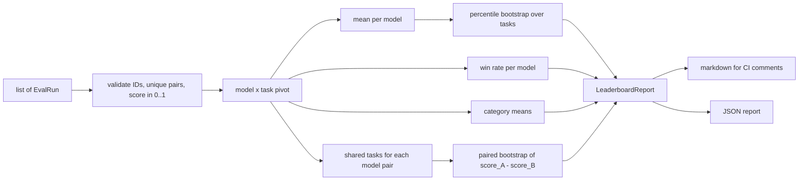

# Leaderboard Aggregation

Per-task scores are easy. Ranking models across heterogeneous tasks is not: one task may be a
pass rate, another a normalized BLEU score, and a third a judge rubric. This module is the
aggregation layer between an eval runner and a leaderboard. It consumes normalized `EvalRun`
records, validates the score contract, and produces a ranked table with means, category means,
task-level win rates, bootstrap confidence intervals, and paired pairwise differences.

It does not run models, call the metric layer, or talk to a provider. NumPy is the only runtime
dependency.

## Quickstart

Prerequisites: Python 3.12 or newer and [uv](https://docs.astral.sh/uv/). From a fresh clone:

```bash
cd llm-eval-from-scratch/74-leaderboard-aggregation
./verify.sh
```

`verify.sh` installs the pinned toolchain into the ignored `.venv`, runs the test suite and
strict mypy, then runs the deterministic demo. It is safe to run repeatedly. The first run may
download pinned packages; the tests and demo themselves perform no network I/O.

Manual commands:

```bash
uv sync --frozen
uv run python main.py demo
uv run pytest -q
uv run mypy main.py
```

`uv run python main.py demo` prints the leaderboard, the pairwise table, and the complete JSON
report. Output is reproducible because the demo seeds the bootstrap with `7`.

## Architecture



The pivot is one record per `(model_id, task_id)`. Per-model intervals resample that model's
task scores. Pairwise intervals resample the per-task differences on tasks both models ran, so
the pairing is preserved.

| Path | Role |
|---|---|
| `main.py` | Validation, aggregation, win rate, bootstrap, pairwise comparisons, markdown/JSON, demo. |
| `tests/test_aggregation.py` | Means, categories, ties, missing-task denominators, validation, weight semantics. |
| `tests/test_bootstrap.py` | Constant intervals, reproducibility, symmetry, alpha nesting, shared-task pairing, invalid inputs. |
| `tests/test_render.py` | Markdown formatting/truncation, alpha labels, JSON schema, empty reports. |
| `tests/test_cli.py` | Deterministic demo output and usage errors. |
| `verify.sh` | Frozen install, tests, strict mypy, demo gate. |
| `pyproject.toml`, `uv.lock` | Pinned NumPy/pytest/mypy toolchain. |

## API

```python
from main import EvalRun, build_report, render_markdown

runs = [
    EvalRun("atlas-7b", "math_arithmetic", "accuracy", 0.90, "math"),
    EvalRun("atlas-7b", "code_python", "pass_rate", 0.82, "code"),
    EvalRun("beacon-13b", "math_arithmetic", "accuracy", 0.80, "math"),
    EvalRun("beacon-13b", "code_python", "pass_rate", 0.75, "code"),
]
report = build_report(runs, b=500, alpha=0.05, seed=7)

print(render_markdown(report.rows, report.alpha))
print(report.to_json())
```

| Symbol | Contract |
|---|---|
| `EvalRun(model_id, task_id, metric_name, score, category="", weight=1.0)` | One model's normalized score on one task. |
| `LeaderboardRow` | `model_id`, `mean_score`, `mean_ci_lo`, `mean_ci_hi`, `win_rate`, `tasks_completed`, `categories`. |
| `aggregate(runs, b=500, alpha=0.05, seed=None)` | Per-model rows sorted by mean, then model id. |
| `win_rate(model_id, runs_by_task, all_models)` | Fraction of completed tasks tied for the best score. |
| `bootstrap_mean_ci(scores, b=1000, alpha=0.05, seed=None)` | Percentile interval for one model's mean. |
| `bootstrap_pairwise_diff(a, b, b=1000, alpha=0.05, seed=None)` | Percentile interval for the paired mean difference. |
| `pairwise_diffs(runs, b=500, alpha=0.05, seed=None)` | All eligible unordered pairs in leaderboard order. |
| `build_report(runs, b=500, alpha=0.05, seed=None)` | Rows, pairwise comparisons, and settings as one report. |
| `render_markdown(rows, alpha=0.05)` | Leaderboard markdown table. |
| `render_pairwise_markdown(pairs, alpha=0.05)` | Pairwise-difference markdown table. |
| `LeaderboardReport.to_json()` | Stable JSON with schema version and settings. |

### Input contract

- `score` must be finite and in `[0, 1]`. A score of `1.5` is rejected rather than rescaled.
  Normalization belongs upstream: the Open LLM Leaderboard, for example, maps each task's raw
  score to a common scale before averaging. The aggregator enforces the resulting contract.
- `model_id`, `task_id`, and `metric_name` must be non-empty. The aggregator records the metric
  name but does not interpret it.
- Exactly one run per `(model_id, task_id)` pair. Duplicates raise instead of silently replacing
  a score.
- `weight` is a reserved hook for future task weighting. It must be finite and positive, but it
  is ignored by every current calculation. Every completed task counts once.
- An empty run list is valid and produces an empty report. The low-level bootstrap helpers
  reject empty score vectors because an interval over zero tasks is undefined.
- Models may have different task coverage. `tasks_completed` exposes the coverage, and the
  win-rate denominator is the model's own completed tasks. Missing coverage is not imputed.

### Mean versus win rate

`mean_score` is the unweighted average of a model's completed task scores. It is the headline
number most leaderboards report. It uses the magnitude of every score, so it is sensitive to
outliers and to which tasks a model happened to run.

`win_rate` counts a full win for every model tied at a task's maximum, then divides by the
number of tasks that model completed. It is less sensitive to score scale and outliers, but it
throws away magnitude: a narrow win and a blowout count the same, and a model that avoids hard
tasks can look strong. The report includes both; ranking is by mean by default. Win rate is a
useful cross-check when means are close or task coverage differs.

### Bootstrap intervals

For a model mean, tasks are sampled with replacement `b` times, the mean is recomputed each
time, and the `alpha/2` and `1 - alpha/2` percentiles of the bootstrap distribution form the
interval. For a model pair, the resampling unit is the per-task difference `score_A - score_B`
on the tasks both models ran. A pairwise interval that excludes zero is flagged significant at
level `alpha`; an interval that contains zero is treated as a tie.

The low-level helpers default to `B=1000`. `aggregate`, `pairwise_diffs`, and `build_report`
default to `b=500` so the demo and tests stay quick. All functions accept `seed` for
reproducibility; the demo uses `seed=7`. No SciPy is used.

Pairs with fewer than two shared tasks are omitted. A one-task bootstrap would return a
zero-width interval and overstate certainty.

### JSON schema

`LeaderboardReport.to_json()` returns strict JSON (`allow_nan=False`) with this shape:

```json
{
  "alpha": 0.05,
  "bootstrap_samples": 500,
  "models": [
    {
      "categories": {"code": 0.82, "math": 0.85},
      "mean_ci_hi": 0.8508333333333334,
      "mean_ci_lo": 0.7858333333333332,
      "mean_score": 0.8191666666666667,
      "model_id": "atlas-7b",
      "tasks_completed": 12,
      "win_rate": 0.6666666666666666
    }
  ],
  "pairwise": [
    {
      "ci_hi": 0.03877083333333332,
      "ci_lo": -0.008812500000000003,
      "mean_diff": 0.017499999999999998,
      "model_a": "atlas-7b",
      "model_b": "beacon-13b",
      "significant": false,
      "tasks_compared": 12
    }
  ],
  "schema_version": 1,
  "seed": 7
}
```

`categories` is omitted when a model has no categorized runs. The JSON arrays follow the
leaderboard order; pairwise objects have the higher-ranked model in `model_a`. Markdown renders
means and interval endpoints to two decimals, pairwise differences to three decimals, and
truncates model ids to twenty characters. A literal `|` in a model id is escaped so the table
stays valid.

## Offline and real-run modes

Everything in this module runs offline: validation, aggregation, the bootstrap, JSON, markdown,
the test suite, and the demo. The only network access is the initial `uv sync` downloading the
pinned toolchain into `.venv`; after that, no code path opens a socket.

There is no provider or GPU mode because this module never calls a model. A real run plugs in at
the adapter boundary: lesson 75's runner evaluates each model/task pair, normalizes the metric
to `[0, 1]`, and emits one `EvalRun` per pair. Feed those records to `build_report` (or
`aggregate` and `pairwise_diffs` separately) and publish the returned markdown/JSON. Provider
credentials, retries, rate limits, and token accounting stay in that runner. The demo fixture is
synthetic and exists only to exercise the aggregation path; it is not a simulated API.

## Measured demo results

Measured locally with `uv run python main.py demo`: 3 synthetic models, 12 tasks, `b=500`,
`alpha=0.05`, `seed=7`. These are deterministic fixture values, **not benchmark results** and
not claims about any real model.

```text
| Rank | Model | Mean | 95% CI | Win rate | Tasks |
|------|-------|------|--------|----------|-------|
| 1 | atlas-7b | 0.82 | 0.79-0.85 | 0.67 | 12 |
| 2 | beacon-13b | 0.80 | 0.77-0.84 | 0.33 | 12 |
| 3 | helios-2026-experime | 0.49 | 0.44-0.53 | 0.00 | 12 |

| Model A | Model B | Mean diff | 95% CI | Significant | Tasks |
|---------|---------|-----------|--------|-------------|-------|
| atlas-7b | beacon-13b | 0.017 | -0.009 to 0.039 | no | 12 |
| atlas-7b | helios-2026-experime | 0.331 | 0.303 to 0.361 | yes | 12 |
| beacon-13b | helios-2026-experime | 0.313 | 0.272 to 0.362 | yes | 12 |
```

The top two models differ by `0.0175` on the mean, but the paired 95% interval is
`[-0.0088, 0.0388]`. The data are consistent with a tie at this sample size; the mean-only
order would overclaim. Both comparisons against the low-scoring model exclude zero.

Per-category means from the same run (three tasks per category):

| Model | math | code | reasoning | safety |
|---|---:|---:|---:|---:|
| atlas-7b | 0.850 | 0.820 | 0.747 | 0.860 |
| beacon-13b | 0.833 | 0.827 | 0.733 | 0.813 |
| helios-2026-experimental | 0.500 | 0.450 | 0.433 | 0.570 |

The category breakdown surfaces a trade-off the headline mean hides: beacon is slightly better
on code, while atlas is ahead on reasoning and safety.

`verify.sh` currently reports 48 passed tests and a clean strict-mypy run, followed by the demo.

## Limitations

- The bootstrap resamples tasks, not individual predictions. It captures task-sampling
  variability but not within-task prediction variance. Tasks from the same family are also
  treated as independent; a hierarchical or clustered bootstrap is the next step for correlated
  task families.
- Per-model intervals are unpaired. Pairwise comparisons are paired on shared tasks, which is
  the appropriate comparison when models ran the same suite.
- Pairwise intervals are marginal 95% intervals, one per comparison. There is no
  family-wise correction (for example Holm or Benjamini-Hochberg); with many models, expect
  some false positives at the 5% level.
- Tasks are unweighted. The reserved `weight` field is validated and ignored. Models with
  different task coverage are compared on their completed-task means, which may not be
  comparable; inspect `tasks_completed` and use the category breakdown.
- Win rate compares only models that were present on a task. A model that skips hard tasks can
  improve its win rate without improving its ability.
- Percentile intervals are first-order; BCa or other second-order intervals can be more
  accurate for small or skewed samples. `b=500` also carries noticeable Monte Carlo noise.
- A model with one completed task gets a zero-width per-model interval. Pairwise rows with
  fewer than two shared tasks are omitted rather than reported with false precision.
- Ties use exact float equality. Markdown truncation to twenty characters can make two long
  model ids render identically.
- The fixture is synthetic. No real benchmark, provider, or GPU was measured.

## References

1. AI Engineering from Scratch, "Leaderboard Aggregation" capstone specification.
   <https://aiengineeringfromscratch.com/learn/capstone-projects/leaderboard-aggregation>
2. Wei-Lin Chiang, Lianmin Zheng, Ying Sheng, Anastasios N. Angelopoulos, Tianle Li, Dacheng
   Li, Hao Zhang, Banghua Zhu, Michael I. Jordan, Joseph E. Gonzalez, Ion Stoica, "Chatbot
   Arena: An Open Platform for Evaluating LLMs by Human Preference", ICML 2024.
   <https://arxiv.org/abs/2403.04132>
3. Hugging Face, "Scores Normalization", Open LLM Leaderboard documentation.
   <https://huggingface.co/docs/leaderboards/en/open_llm_leaderboard/normalization>
4. EleutherAI, `lm-evaluation-harness`: `lm_eval/api/metrics.py` (bootstrap standard errors for
   eval metrics). <https://github.com/EleutherAI/lm-evaluation-harness/blob/main/lm_eval/api/metrics.py>
5. Bradley Efron and Balasubramanian Narasimhan, "The automatic construction of bootstrap
   confidence intervals", *Journal of Computational and Graphical Statistics* 29(3), 2020.
   <https://pmc.ncbi.nlm.nih.gov/articles/PMC7958418/>
