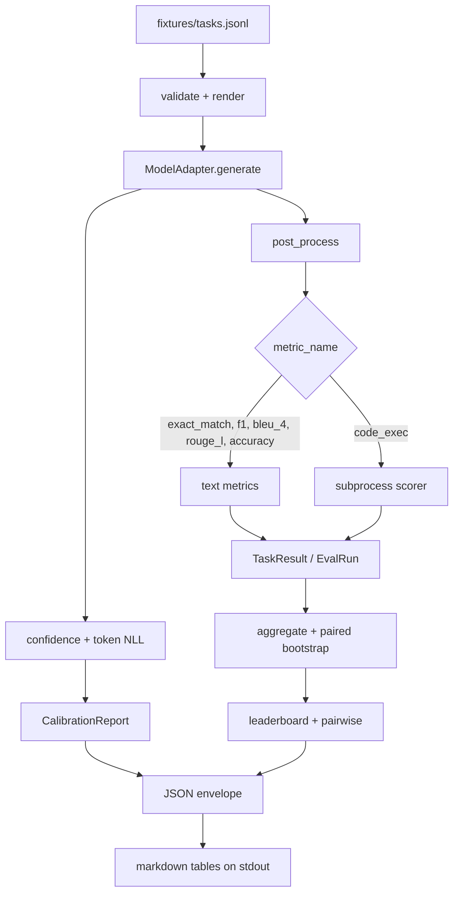

# End-to-End Eval Runner

An offline, self-terminating evaluation pipeline that composes the five layers from the track's
eval lessons: a frozen task contract, model adapters, classical and code-execution metrics,
calibration reports, and a leaderboard. One command validates ten JSONL tasks, runs three
deterministic mock models, scores every generation, measures calibration, ranks the models, and
writes a JSON envelope plus pasteable markdown tables.

The demo exits 0 only when every task is validated and scored, every model has a calibration
report, and the rule-based adapter ranks strictly above the noisy baseline. Validation, runtime,
and gate failures write a structured error envelope and exit 1. There are no API keys and no
network calls in the tests or demo.

## Architecture



The published spec describes importing lessons 70–74 through a sibling-path helper. This module
must be independently verifiable, so it keeps the same layer boundaries but owns original local
implementations. There are no imports or path hacks from sibling modules.

| Path | Role |
|---|---|
| `main.py` | Demo adapters, clean-run gate, CLI entry point. |
| `eval_runner/tasks.py` | Frozen JSONL contract, validator, few-shot renderer, post-process rules. |
| `eval_runner/adapter.py` | `Generation`, `ModelAdapter` protocol. |
| `eval_runner/metrics.py` | Exact match, accuracy, token F1, BLEU-4, ROUGE-L. |
| `eval_runner/code_exec.py` | Fenced-code extraction, subprocess execution, assertion scoring. |
| `eval_runner/calibration.py` | Reliability bins, ECE, Brier score. |
| `eval_runner/aggregation.py` | Means, category means, win rates, bootstrap intervals, paired diffs. |
| `eval_runner/runner.py` | Single-pass scoring loop, thread pool, calibration buffers, JSON envelope. |
| `fixtures/tasks.jsonl` | Ten synthetic tasks: two per category, six metrics, six post-process rules. |
| `fixtures/tasks_invalid.jsonl` | Three intentionally invalid records for the error path. |
| `tests/` | 43 offline tests covering contracts, metrics, sandboxing, calibration, aggregation, concurrency, CLI, and failure paths. |
| `verify.sh` | Frozen install, tests, strict mypy, clean demo, and structured-error check. |

## The adapter seam

```python
from eval_runner import Generation, ModelAdapter


class MyAdapter:
    model_id = "provider/model-v1"

    def generate(self, prompt: str, task: TaskSpec) -> Generation:
        text = call_my_model(prompt)
        return Generation(
            text=text,
            confidence=0.80,          # required, in [0, 1]
            token_nll=4.2,            # optional sum of -log p over generated tokens
            token_count=12,           # optional generated-token count
        )
```

Any object with `model_id: str` and this one method is a valid adapter; there is no base class to
inherit. The runner calls `generate` once per task, renders the few-shot prompt first, validates
the returned `Generation`, post-processes the text, dispatches to the metric, and records
`(confidence, correct)` for calibration. Adapters must be thread-safe when `parallel=True`.

The three demo adapters are deliberately simple and deterministic:

- `RuleBasedAdapter` computes arithmetic, recognizes classification keywords, emits working
  `add`/`reverse` code, and uses the fixture target for MCQ/summary. It is an oracle-style mock
  for those categories, not a model, and scores 1.00 on this fixture.
- `NoisyAdapter` is the hash-seeded random baseline. It always returns a wrong answer with
  confidence 0.93. Its mean is near zero rather than exactly zero because BLEU smoothing can
  award partial n-gram credit.
- `BiasedAdapter` is correct on classification and summary, wrong on arithmetic/MCQ/code, and
  confident on both. Its 0.40 mean with 0.52 ECE demonstrates that accuracy and calibration are
  different properties.

## Quickstart

Prerequisites: Python 3.12+ and [uv](https://docs.astral.sh/uv/). From a fresh clone:

```bash
cd llm-eval-from-scratch/75-end-to-end-eval-runner
./verify.sh
```

`verify.sh` installs the pinned pytest/mypy toolchain into the ignored `.venv`, runs all tests and
strict mypy, runs the demo, checks the JSON and markdown, and checks that the invalid fixture exits
non-zero with a structured error. It is safe to run repeatedly. The first run may download the
pinned dev dependencies; the tests and demo never touch the network.

Manual commands:

```bash
uv sync --frozen
uv run python main.py demo
uv run python main.py demo --no-parallel --bootstrap 200 --seed 7
uv run python main.py demo --json-out artifacts/eval_report.json
uv run pytest -q
uv run mypy main.py eval_runner
```

`python main.py demo` prints the leaderboard, pairwise table, and calibration table to stdout, and
writes the JSON envelope to `artifacts/eval_report.json` (ignored by git). A status line with the
measured wall time goes to stderr, keeping stdout clean for a PR comment.

## What runs offline

Everything shipped here runs offline:

- JSONL validation and prompt rendering are local.
- The mock adapters are deterministic, hash-seeded Python.
- Text metrics are stdlib implementations.
- `code_exec` spawns a local Python subprocess with a denied-import list, a wall-clock timeout,
  and a 256 KiB output cap.
- Calibration and bootstrap aggregation are stdlib arithmetic.

The code sandbox is educational isolation, **not** a security boundary; do not run untrusted
candidate code with it. API adapters, retries, caching, rate-limit handling, cost accounting, and
streaming are intentionally outside this runner.

## Optional real provider or GPU mode

The same `ModelAdapter` protocol accepts a real provider. Keep credentials in environment
variables and keep network code inside the adapter, never in the runner or tests:

```python
import os

from eval_runner import Generation


class ProviderAdapter:
    model_id = "provider/model-v1"

    def __init__(self, call):
        self._call = call          # e.g. a client or HTTP request wrapper
        self._api_key = os.environ["PROVIDER_API_KEY"]

    def generate(self, prompt, task):
        text = self._call(prompt, api_key=self._api_key)
        return Generation(text=text, confidence=0.5)
```

If the provider returns token log-probabilities, compute a real confidence (for example
`exp(mean token log-probability)`) and set `token_nll`/`token_count`. If it does not, the constant
above is only a placeholder: the calibration block is then uninformative and should not be
interpreted as the provider's calibration. A local transformers adapter can target a GPU by owning
its device placement and batching behind the same `generate` method; the runner, metrics, and
leaderboard do not change. No live-provider code is shipped, so `verify.sh` stays offline.

## Measured demo results

Measured locally with the default parallel demo, seed 7, 500 bootstrap samples. These are
deterministic values from the synthetic fixture and mock adapters, not benchmark, provider, or GPU
results.

```text
| Rank | Model | Mean | 95% CI | Win rate | Tasks |
|------|-------|------|--------|----------|-------|
| 1 | rule_based | 1.00 | 1.00-1.00 | 1.00 | 10 |
| 2 | biased | 0.40 | 0.10-0.70 | 0.40 | 10 |
| 3 | noisy | 0.02 | 0.00-0.05 | 0.00 | 10 |

| Model A | Model B | Mean diff | 95% CI | Significant | Tasks |
|---------|---------|-----------|--------|-------------|-------|
| rule_based | biased | 0.600 | 0.300 to 0.900 | yes | 10 |
| rule_based | noisy | 0.982 | 0.945 to 1.000 | yes | 10 |
| biased | noisy | 0.382 | 0.100 to 0.682 | yes | 10 |

| Model | ECE | Brier | Populated bins | Samples |
|-------|-----|-------|----------------|---------|
| rule_based | 0.030 | 0.001 | 1 | 10 |
| biased | 0.520 | 0.487 | 1 | 10 |
| noisy | 0.930 | 0.865 | 1 | 10 |
```

Observed wall time is 0.10–0.14 seconds for 10 tasks × 3 models in repeated local runs, well under
the demo's ten-second budget. The test suite reports 43 passed tests and strict mypy reports no
issues. The rule-based adapter is strictly above the noisy baseline; the demo gate also verifies
that all 30 model/task results and all three calibration reports exist.

Reproduce those numbers directly:

```bash
uv run python main.py demo --seed 7 --bootstrap 500 --json-out /tmp/eval-report.json
uv run python main.py demo --no-parallel --seed 7 --bootstrap 500 --json-out /tmp/eval-seq.json
```

The parallel and sequential JSON files have identical per-task scores, leaderboard, pairwise
intervals, and calibration blocks; only `summary.wall_seconds`, `summary.parallel`,
`summary.workers`, and per-call `duration_ms` differ. The seed and bootstrap count are recorded
in the envelope so the markdown table can be traced back to the run that produced it.

The noisy mean is not exactly zero: its summary generation shares enough tokens with one BLEU-4
reference to earn partial credit under add-one smoothing. It remains far below the biased and
rule-based adapters.

## Verification details

`verify.sh` checks:

1. `uv sync --frozen` succeeds with the committed lockfile.
2. Pytest passes all 43 tests.
3. Strict mypy passes `main.py` and `eval_runner`.
4. The clean demo exits 0 and produces the expected envelope, 30 results, three calibration
   blocks, rank 1 `rule_based`, and a rule-based mean above the noisy mean.
5. `fixtures/tasks_invalid.jsonl` exits 1 with `status: "error"`, `stage: "validate"`, and three
   structured error details.

The JSON envelope has `schema_version`, `status`, `summary`, `leaderboard`, `pairwise`,
`calibration`, and per-task `results`. `EvalReport.to_json()` is strict JSON (`allow_nan=False`).
On failure the CLI writes the same envelope shape with `status: "error"` and an `error` object
carrying `stage`, `type`, `message`, and optional `details`:

```json
{
  "schema_version": 1,
  "status": "error",
  "error": {
    "stage": "validate",
    "type": "FixtureValidationError",
    "message": "fixtures/tasks_invalid.jsonl: 3 invalid record(s); ...",
    "details": [{"line": 1, "rule": "unknown_field", "field": "unexpected", "message": "..."}]
  }
}
```

## Limitations

- The adapters are mocks and the fixture is ten synthetic tasks. Nothing here measures a real
  model, provider, or GPU.
- Rule-based categories use fixture targets directly; that is an oracle for a demo, not a
  capability claim.
- BLEU-4 and ROUGE-L are surface-overlap heuristics with known weaknesses (paraphrase blindness,
  tokenization sensitivity, and smoothing choices). They are not substitutes for human or
  model-based grading.
- The code sandbox is subprocess isolation for fixture code, not a hardened security boundary.
- Bootstrap intervals resample tasks and treat them as independent; ten tasks produce wide
  intervals, and the pairwise intervals are marginal with no family-wise correction.
- Calibration trusts the adapter's self-reported confidence. A provider without log-probabilities
  needs a documented constant or a different signal, and its ECE should not be overinterpreted.
- There is no retry, cache, rate-limit, cost-ledger, streaming, or sampling policy. Those belong
  in adapter wrappers or a production orchestration layer.
- Parallel execution is per model; three local mocks do not demonstrate network-I/O speedup.

## References

1. AI Engineering from Scratch, “End-to-End Eval Runner” capstone specification.
   <https://aiengineeringfromscratch.com/learn/capstone-projects/end-to-end-eval-runner>
2. Anthropic, “Demystifying evals for AI agents” — harness definition, code-based graders, and
   running tasks concurrently. <https://www.anthropic.com/engineering/demystifying-evals-for-ai-agents>
3. OpenAI, “Evaluation best practices” — task-specific evals, automated scoring, and the
   anti-pattern of relying only on generic metrics.
   <https://developers.openai.com/api/docs/guides/evaluation-best-practices>
4. scikit-learn, “Probability calibration” — reliability diagrams and the Brier score
   decomposition. <https://scikit-learn.org/stable/modules/calibration.html>
5. Stella Biderman et al., “Lessons from the Trenches on Reproducible Evaluation of Language
   Models” — prompt/methodology disclosure and reporting uncertainty.
   <https://arxiv.org/abs/2405.14782>
